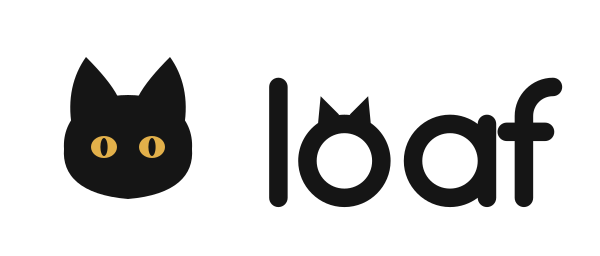
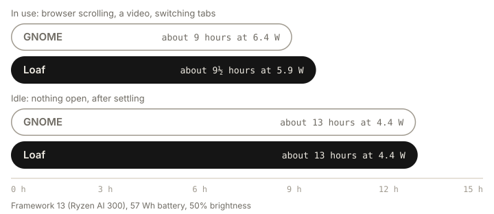

<p align="center">
  <picture>
    <source media="(prefers-color-scheme: dark)" srcset="docs/loaf-dark.svg">
    
  </picture>
</p>

<h3 align="center">A desktop that naps.</h3>

<p align="center">
  A quiet desktop for Linux laptops, built on <a href="https://github.com/YaLTeR/niri">niri</a>.<br>
  Nothing moves when you are not looking, so the battery goes to your work instead of the desktop.<br>
  It sits next to GNOME as a second login choice; GNOME stays one logout away.
</p>

<br>

<p align="center">
  <picture>
    <source media="(prefers-color-scheme: dark)" srcset="docs/battery-dark.svg">
    
  </picture>
</p>

<p align="center"><sub>Same laptop, same brightness, nothing open. Method and raw numbers in <a href="measurements/"><code>measurements/</code></a> and <a href="tools/baseline.py"><code>tools/baseline.py</code></a>.</sub></p>

## When you stop, it stops

| Part | While you are not using it |
|---|---|
| **The clock** | ticks once a minute, not once a second |
| **Wi-Fi** | only looks for networks while the list of networks is open |
| **Notifications** | wait until an app sends one; nothing checks in the background |
| **Sleep** | about 0.65 W, one percent of battery an hour |
| **Login** | five of Ubuntu's background helpers are skipped in Loaf (GNOME keeps them) |

## What is in it

- **The bar.** The cat opens the launcher, then workspace dots, the date and time, and on the right Wi-Fi
  (with signal strength, a plug on a cable), watts in or out, time to empty or full, and the battery.
- **Tray.** Apps that keep running without a window (Steam, Teams, Spotify) show their icon in the bar.
  Click to open the app, right click for its own menu, with Quit.
- **Launcher** (Super+D). Apps, settings and files in one search; an app that is already open gets focused.
- **Notifications.** Cards in the corner, also over fullscreen windows. Missed one? Click the date and time:
  they wait there, with a dot next to the clock until you look. Do not disturb lets only urgent ones through.
- **Quick settings** (the right side of the bar). Battery with time left, the power menu, Wi-Fi and Bluetooth
  lists, power saver, dark style, do not disturb, screen mirroring, volume and brightness.
- **Lock screen.** Your finger or your password, on every screen. Without a fingerprint reader it simply asks
  for the password; with one, it recovers by itself after a suspend.
- **Light and dark** follow your system setting, and GTK apps, the login screen and the boot screen come along.
- **A low-battery warning** at 20%, and one that stays at 10% and 5%.

## Install

Loaf is for Ubuntu 26.04 on a laptop. Every way below adds "Loaf" to the login screen next to GNOME and gives the
login and boot screen Loaf's look; taking Loaf off puts Ubuntu's back.

**On a new laptop: the installer.** `packaging/build-iso.sh` takes Ubuntu's own 26.04.1 desktop ISO (put it and
Ubuntu's `SHA256SUMS` in `iso/`) and adds Loaf plus everything it needs, so installing works offline. Ubuntu's
installer asks all its usual questions; at the end it installs Loaf and starts your new account on it.
Runs in Docker, no sudo.

**On your Ubuntu laptop: the package.**

```sh
packaging/build-deb.sh
sudo apt install ./packaging/out/loaf_*.deb
```

**From the repository**, for every user on the computer, with an undo:

```sh
sudo ./install.sh --system
sudo ./install.sh --system-undo   # takes it all off again
```

For working on Loaf itself, `./install.sh` (no sudo) links the repository into your home folder, which wins over
the system copy.

<details>
<summary>Building niri, xwayland-satellite and Quickshell first</summary>

The sources go in `src/` (ignored by git). niri v26.04 and xwayland-satellite v0.8.3 build with
`cargo build --release`; Quickshell 0.3.2 with
`cmake -GNinja -B build -DCMAKE_BUILD_TYPE=Release -DCRASH_HANDLER=OFF`. Clone niri with the git-lfs filter
disabled (its LFS files are screenshots).
</details>

## Keys

| Key | Does |
|---|---|
| Super+D | Launcher |
| Super+T | Terminal (`$TERMINAL`, else the first of Ghostty, Console, GNOME Terminal, foot, Alacritty, kitty, xterm) |
| Super+X | Power menu |
| Super+Alt+L | Lock |
| Super+P | Mirror to an external screen |
| Super+Shift+S | Screenshot of an area |
| Super+Shift+D | fuzzel, the fallback launcher |
| Super+Shift+E | Log out |

## Make it yours

Your own niri settings (screens and their refresh rates, rules for your apps, extra things to start) go in
`~/.config/loaf/niri.kdl`. Loaf's config includes it last, so it can override anything. The shell logs to
`~/.cache/loaf/qs.log`.

## Loaf for Claude

A theme for the Claude app in Loaf's look: paper and ink with no accent colour, the cat napping behind the
conversation, and bread words while it works (*Proofing*, *Kneading*, *Baking*). Light and dark follow the app.
In a terminal session of Claude Code:

```
/plugin install loaf-theme --marketplace CaptainPancakeWithBacon/loaf
```

From a shell: `claude plugin install loaf-theme --marketplace CaptainPancakeWithBacon/loaf`. In the desktop app:
click + next to the prompt box, then Plugins, Add marketplace with `CaptainPancakeWithBacon/loaf`, then Add plugin.

## Inside the repository

| Folder | What |
|---|---|
| `loaf/` | the shell (Quickshell): bar, launcher, quick settings, notifications, lock, theme, logo files |
| `niri/make-config.py` | builds Loaf's niri config from niri's own default with a few exact changes; fails loudly when one no longer fits |
| `session/` | starting the session (niri runs as `niri.service`, which the portals need), helper scripts, system rules |
| `boot/` | login logo, login screen theme (`boot/gdm/`), boot screen (`boot/plymouth/`) |
| `packaging/` | the `.deb` and the installer ISO |
| `site/` | the website, a page that naps |
| `claude-theme/` | Loaf for the Claude app: paper and ink, the napping cat, bread words while it works (a Claude Code mod) |
| `measurements/`, `tools/` | the power measurements and the tool that takes them |

## Credits

Loaf runs on [niri](https://github.com/YaLTeR/niri) (GPL-3.0) and [Quickshell](https://quickshell.org)
(LGPL-3.0). Loaf's own code is MIT, see [`LICENSE`](LICENSE). Made on a Framework 13, mostly while it napped.
